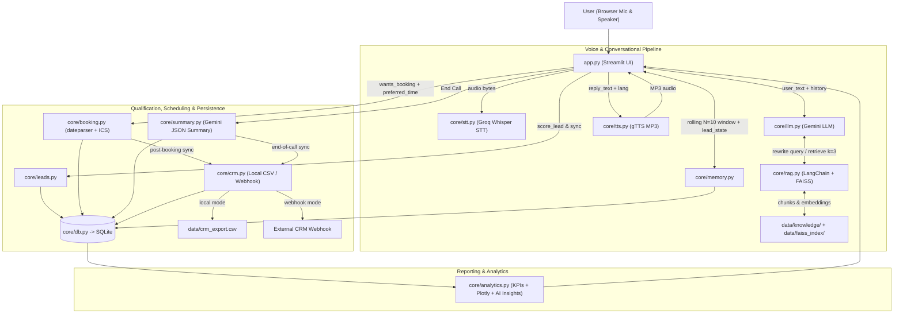
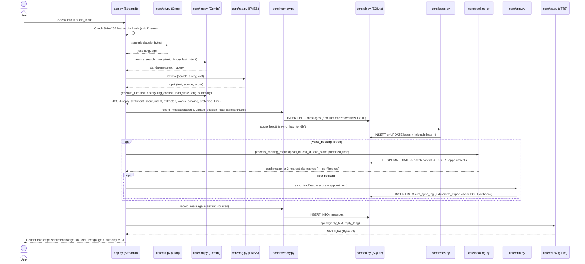

# System Architecture

The Autonomous AI Sales Voice Agent separates presentation (`app.py`) from single-concern domain modules inside `core/`.

## Module Responsibilities

| Module | Concern | Key External / Local Dependency |
| :--- | :--- | :--- |
| `app.py` | Streamlit UI, sidebar KB controls, audio deduplication | `streamlit` |
| `core/config.py` | Environment loading (`.env`), constants, logging setup | `python-dotenv`, `logging` |
| `core/db.py` | Schema creation (`init_db`) and parameterized CRUD | `sqlite3` (`data/db/sales_agent.db`) |
| `core/stt.py` | Audio transcription & auto language detection | Groq Whisper (`whisper-large-v3-turbo`) |
| `core/tts.py` | Language mapping (`en`, `hi`, `pa`, `es`, `fr`) & MP3 synthesis | `gTTS` (in-memory `BytesIO`) |
| `core/rag.py` | Document loading, chunking, FAISS index build/load, top-k retrieval | LangChain, FAISS, `gemini-embedding-001` |
| `core/llm.py` | Contextual query rewriting, JSON-mode turn generation, summarization | `ChatGoogleGenerativeAI` (`gemini-2.5-flash`) |
| `core/memory.py` | Rolling `N=10` window + summary compression, `lead_state` merge | `core/db.py`, `core/llm.py` |
| `core/leads.py` | Rule-based 0–100 scoring (`Hot`/`Warm`/`Cold`) and SQLite lead sync | `core/db.py` |
| `core/booking.py` | `Asia/Kolkata` slot parsing, `BEGIN IMMEDIATE` conflict check, `.ics` export | `dateparser`, `zoneinfo`, `core/db.py` |
| `core/crm.py` | Pluggable CRM sync (`local` CSV/log or `webhook` POST with retries) | `requests`, `csv`, `core/db.py` |
| `core/summary.py` | Post-call structured JSON summary persisted to `calls` | `core/llm.py`, `core/db.py` |
| `core/analytics.py` | KPI calculation, summary aggregation, Plotly charts, AI insights | `plotly`, `core/db.py`, `core/llm.py` |

## High-Level System Architecture

## Single Voice Turn Data Flow

